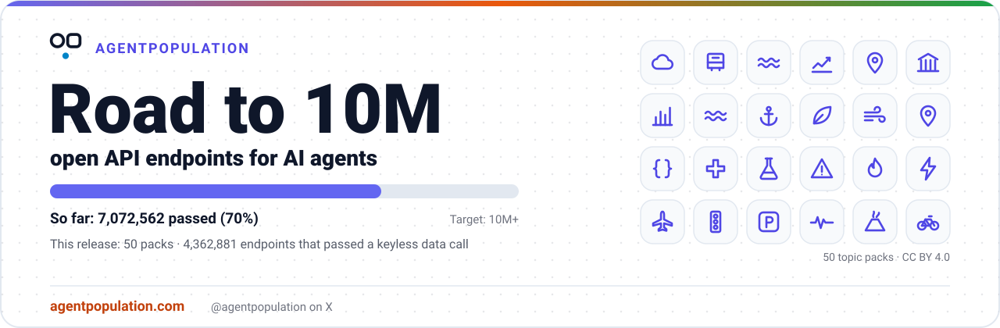

Target: 10 million+ open API endpoints that pass a keyless API call.

So far: 7,072,562 passed (70%).

Progress to the target: `██████████████░░░░░░`

This release: the 24 packs below hold **3,533,583** endpoints that passed a keyless data call, each counted once across packs.

  

Compiled by <a href="https://agentpopulation.com">AgentPopulation</a> with <a href="https://github.com/agentpopulation/apdesk">AP Desk</a> · <a href="https://x.com/agentpopulation">@agentpopulation</a>

## Road to 10M open API endpoints for AI agents

The packs below come from the snapshot of 15 Nov 2026: **5,129,834** tested in it, **3,726,509** passed a data call.

> For the latest tested endpoints, search [agentpopulation.com/apis](https://agentpopulation.com/apis). These packs are a snapshot from 15 Nov 2026.

Public API endpoints that answered a keyless GET with a data body, published pack by pack for agent and app builders. Each pack is picked for one kind of agent or app; its repository holds a sample and the tools, and its full list is a release download. Each repository name carries its pack's count, rounded down.

**What is an API endpoint?** An API endpoint is one web address that a program can ask for data, for example the latest reading at one weather station. A single service, such as a national weather agency, can have thousands of endpoints: one per station, city or dataset. These packs count endpoints, not separate services.

## Live packs

### First packs

| Pack | What you can build with it | Endpoints | Services | Repository |
|---|---|---:|---:|---|
| 🌦️ Weather API endpoints | Build a weather agent or app. Station observations, forecasts, climate series and air quality. | 190,644 | 9,237 | [190k-weather-apis-for-agents](https://github.com/agentpopulation/190k-weather-apis-for-agents) |
| 🚆 Transit API endpoints | Build a transport agent or app. Bus, rail and bike-share feeds, traffic and parking. | 271,658 | 14,930 | [270k-transit-apis-for-agents](https://github.com/agentpopulation/270k-transit-apis-for-agents) |
| 🌊 Rivers and water API endpoints | Build a river, flood or tide agent or app. River gauges, floods, tides, oceans and groundwater. | 279,947 | 12,045 | [270k-water-apis-for-agents](https://github.com/agentpopulation/270k-water-apis-for-agents) |
| 📈 Finance and economy API endpoints | Build an economy or statistics agent or app. Economic indicators, official statistics tables and finance datasets. | 130,603 | 4,417 | [130k-finance-economy-apis-for-agents](https://github.com/agentpopulation/130k-finance-economy-apis-for-agents) |
| 🧭 India API endpoints | Build an agent or app for India. Endpoints tagged country IN: data about India or served from Indian domains. | 131,489 | 2,180 | [130k-india-apis-for-agents](https://github.com/agentpopulation/130k-india-apis-for-agents) |

### Big

| Pack | What you can build with it | Endpoints | Services | Repository |
|---|---|---:|---:|---|
| 🏛️ Government open data API endpoints | Build civic and city agents and apps on open-data portals. City, regional and national open-data portals: dataset records, municipal files and civic map layers. | 1,329,192 | 57,593 | [1.3m-government-open-data-apis](https://github.com/agentpopulation/1.3m-government-open-data-apis) |
| 📊 Statistics and census API endpoints | Answer questions with official statistics and census tables. National statistics tables, census and population data, World Bank, UN SDG and Eurostat indicators. | 292,624 | 27,495 | [290k-statistics-apis-for-agents](https://github.com/agentpopulation/290k-statistics-apis-for-agents) |
| 🐋 Ocean and marine API endpoints | Build a sea-state, buoy or marine-data tool. Ocean datasets, sea level and tide gauges, buoys, sea temperature and marine map layers. | 86,107 | 2,241 | [86k-oceans-apis-for-agents](https://github.com/agentpopulation/86k-oceans-apis-for-agents) |
| 🌿 Environment API endpoints | Track pollution, biodiversity and land. Species records, air quality, radiation, emissions, waste, soils, forests and protected areas. | 174,406 | 11,421 | [170k-environment-apis-for-agents](https://github.com/agentpopulation/170k-environment-apis-for-agents) |
| 🗺️ Maps and GIS API endpoints | Add map layers and place data to an agent or app. Map layers, administrative boundaries, parcels, land-use plans, gazetteers and postal codes. | 387,310 | 18,772 | [380k-maps-gis-apis-for-agents](https://github.com/agentpopulation/380k-maps-gis-apis-for-agents) |
| 🤖 Agent-ready API endpoints | Give an AI agent endpoints it can call with no key and read as JSON. Endpoints across topics that needed no key and answered with a JSON body: readings, indicators, records and map layers. | 2,518,343 | 65,954 | [2.5m-agent-ready-apis](https://github.com/agentpopulation/2.5m-agent-ready-apis) |

### Mid-size

| Pack | What you can build with it | Endpoints | Services | Repository |
|---|---|---:|---:|---|
| ⚓ Maritime API endpoints | Build a ship, port or harbour tool. Port calls, port and ferry layers, nautical chart features, shipping statistics and German marine monitoring files. | 24,827 | 3,457 | [24k-maritime-apis-for-agents](https://github.com/agentpopulation/24k-maritime-apis-for-agents) |
| 🏥 Health API endpoints | Build a health, hospital or disease lookup. Health indicators by country, hospital and clinic layers, disease and COVID-19 tables. | 96,866 | 5,827 | [96k-health-apis-for-agents](https://github.com/agentpopulation/96k-health-apis-for-agents) |
| 🔬 Science API endpoints | Build a science lookup or research assistant. Geology layers, sunrise and sunset times, space and satellite feeds, biodiversity and research data. | 384,890 | 6,223 | [380k-science-apis-for-agents](https://github.com/agentpopulation/380k-science-apis-for-agents) |
| ⚠️ Hazards and alerts API endpoints | Build a hazard map or alert tool. Weather alerts and warnings, hazard outlooks, flood, fire, landslide, volcano and earthquake hazard layers. | 53,354 | 6,381 | [53k-hazards-apis-for-agents](https://github.com/agentpopulation/53k-hazards-apis-for-agents) |
| ⚡ Energy API endpoints | Build an electricity, renewables or fuel tool. Electricity generation, prices and grid data, renewables, power plants, fuel and energy statistics. | 72,606 | 5,304 | [72k-energy-apis-for-agents](https://github.com/agentpopulation/72k-energy-apis-for-agents) |
| ✈️ Aviation API endpoints | Build an airport-weather or flight tool. Airport weather (METAR and TAF), aircraft positions, airports, runways, airspace and air-traffic statistics. | 25,002 | 2,574 | [25k-aviation-apis-for-agents](https://github.com/agentpopulation/25k-aviation-apis-for-agents) |

### Small "build one thing"

| Pack | What you can build with it | Endpoints | Services | Repository |
|---|---|---:|---:|---|
| 🌫️ Air quality API endpoints | Build an air-quality widget or agent. Pollutant readings by city and station, PM2.5 by country, pollution maps and yearly series. | 20,830 | 1,511 | [20k-air-quality-apis-for-agents](https://github.com/agentpopulation/20k-air-quality-apis-for-agents) |
| 🔥 Wildfire API endpoints | Build a wildfire and fire-danger map. Wildfire perimeters and incidents, fire-danger ratings, fire weather outlooks, fire history and wildfire-risk layers. | 6,584 | 1,279 | [6.5k-wildfire-apis-for-agents](https://github.com/agentpopulation/6.5k-wildfire-apis-for-agents) |
| 🚦 Traffic and roadworks API endpoints | Build a traffic, roadworks or road-safety tool. Traffic counts, road weather stations, crash and incident layers, roadworks and closures. | 24,641 | 2,782 | [24k-traffic-apis-for-agents](https://github.com/agentpopulation/24k-traffic-apis-for-agents) |
| 🅿️ Parking API endpoints | Build a parking finder. Car parks and garages, on-street zones and meters, occupancy sensors, accessible bays and parking tickets. | 12,327 | 3,189 | [12k-parking-apis-for-agents](https://github.com/agentpopulation/12k-parking-apis-for-agents) |
| 🌍 Earthquake API endpoints | Build an earthquake lookup or map. Earthquake event queries, fault lines, seismic-hazard and liquefaction layers. | 10,873 | 1,324 | [10k-earthquake-apis-for-agents](https://github.com/agentpopulation/10k-earthquake-apis-for-agents) |
| 🌋 Volcano and tsunami API endpoints | Build a volcano and tsunami hazard lookup. Volcano locations and hazard zones, eruption lists, tsunami evacuation zones and tsunami model grids. | 5,280 | 903 | [5.2k-volcano-tsunami-apis-for-agents](https://github.com/agentpopulation/5.2k-volcano-tsunami-apis-for-agents) |
| 🚲 Bike-share API endpoints | Build a bike and dock availability tool. GBFS feeds for shared bikes, e-scooters and mopeds: station status, vehicles, prices and no-parking zones. | 17,121 | 281 | [17k-bike-share-apis-for-agents](https://github.com/agentpopulation/17k-bike-share-apis-for-agents) |

Left out of the packs, by the rule the website uses: 102,909 rows of server information from Mastodon, PeerTube, Lemmy, Nostr and other social network servers (instance documents name the server's contact person), 43,878 ArcGIS Survey123 layers (they can hold people's form answers), 29,512 ArcGIS class or coursework layers (lab, assignment, exam, quiz, lesson, exercise, tutorial and final-project layers, copies of class layers, layers named for a person or a person's home, and layers whose name ends in a person's name or holds a student number), 3,778 rows whose URL carried a credential-looking parameter or a login, 2,829 ArcGIS layers that hold reports, comments, submissions or form responses sent in by the public, 480 rows with a private or local address, 149 rows with an email-like address, 122 rows that passed a data call only from a network location in India, 14 camera or image URLs (webcam and camera feeds, picture and video files), 6 rows whose address or title held a token-like string, a private address or a similar string and 1 row that repeats an address already in the pack.

Also left out of the packs, though the website lists them: 7,384 ArcGIS layers that keep a form's default service name (they can hold people's form answers), 1,241 class-exercise copies of the same few ArcGIS Online layers (Miami Beach sea level rise, high-risk areas without shelter, flooded areas, sea level rise and storm surge maps) across many organisations, many with a person's name in the title, 508 layers marked editable in the title (they can hold entries that people added) and 65 police traffic-stop layers (they can hold details of people stopped).

Endpoints per pack by what you build

Buckets overlap; a row can fit more than one. Each pack README lists recommended starting points for each bucket, with the criteria that picked them, and the same lists as recommended.json.

| Pack | 🤖 Agent tools | 📱 App features | 🧠 Grounding and data pipelines | 🧪 Evals and testing |
|---|---:|---:|---:|---:|
| **First packs** | | | | |
| [Weather API endpoints](https://github.com/agentpopulation/190k-weather-apis-for-agents) | 17,565 | 78,138 | 66,307 | 190,644 |
| [Transit API endpoints](https://github.com/agentpopulation/270k-transit-apis-for-agents) | 16,136 | 33,256 | 38,441 | 271,658 |
| [Rivers and water API endpoints](https://github.com/agentpopulation/270k-water-apis-for-agents) | 42,576 | 43,976 | 113,774 | 279,947 |
| [Finance and economy API endpoints](https://github.com/agentpopulation/130k-finance-economy-apis-for-agents) | 18,722 | 38,193 | 25,354 | 130,603 |
| [India API endpoints](https://github.com/agentpopulation/130k-india-apis-for-agents) | 261 | 8,289 | 6,345 | 131,489 |
| **Big** | | | | |
| [Government open data API endpoints](https://github.com/agentpopulation/1.3m-government-open-data-apis) | 120,356 | 27,403 | 311,011 | 1,329,192 |
| [Statistics and census API endpoints](https://github.com/agentpopulation/290k-statistics-apis-for-agents) | 28,083 | 15,603 | 84,859 | 116,536 |
| [Ocean and marine API endpoints](https://github.com/agentpopulation/86k-oceans-apis-for-agents) | 1,409 | 8,394 | 65,097 | 86,107 |
| [Environment API endpoints](https://github.com/agentpopulation/170k-environment-apis-for-agents) | 34,035 | 5,880 | 13,026 | 174,406 |
| [Maps and GIS API endpoints](https://github.com/agentpopulation/380k-maps-gis-apis-for-agents) | 70,229 | 98,806 | 69,099 | 387,310 |
| [Agent-ready API endpoints](https://github.com/agentpopulation/2.5m-agent-ready-apis) | 84,731 | 81,911 | 206,812 | 2,518,343 |
| **Mid-size** | | | | |
| [Maritime API endpoints](https://github.com/agentpopulation/24k-maritime-apis-for-agents) | 5,035 | 5,056 | 1,390 | 24,827 |
| [Health API endpoints](https://github.com/agentpopulation/96k-health-apis-for-agents) | 46,240 | 6,143 | 34,865 | 96,866 |
| [Science API endpoints](https://github.com/agentpopulation/380k-science-apis-for-agents) | 2,870 | 12,574 | 54,693 | 384,890 |
| [Hazards and alerts API endpoints](https://github.com/agentpopulation/53k-hazards-apis-for-agents) | 25,041 | 283 | 6,858 | 53,354 |
| [Energy API endpoints](https://github.com/agentpopulation/72k-energy-apis-for-agents) | 418 | 9,067 | 23,852 | 72,606 |
| [Aviation API endpoints](https://github.com/agentpopulation/25k-aviation-apis-for-agents) | 10,551 | 6,417 | 1,725 | 25,002 |
| **Small "build one thing"** | | | | |
| [Air quality API endpoints](https://github.com/agentpopulation/20k-air-quality-apis-for-agents) | 8,148 | 4,751 | 10,260 | 20,830 |
| [Wildfire API endpoints](https://github.com/agentpopulation/6.5k-wildfire-apis-for-agents) | 2,986 | 565 | 1,288 | 6,584 |
| [Traffic and roadworks API endpoints](https://github.com/agentpopulation/24k-traffic-apis-for-agents) | 9,352 | 1,080 | 9,092 | 24,641 |
| [Parking API endpoints](https://github.com/agentpopulation/12k-parking-apis-for-agents) | 7,540 | 3,266 | 2,536 | 12,327 |
| [Earthquake API endpoints](https://github.com/agentpopulation/10k-earthquake-apis-for-agents) | 5,567 | 7,199 | 2,101 | 10,873 |
| [Volcano and tsunami API endpoints](https://github.com/agentpopulation/5.2k-volcano-tsunami-apis-for-agents) | 2,399 | 464 | 280 | 5,280 |
| [Bike-share API endpoints](https://github.com/agentpopulation/17k-bike-share-apis-for-agents) | 3,257 | 4,269 | 8,390 | 17,121 |

## Coming next

Planned packs, in the order they are planned, with no dates yet. They have no selection rule yet, so they get a count when they are built.

### Special

| Planned pack | What you can build with it | Endpoints | Rule | Status |
|---|---|---:|---|---|
| Starter 1,000 | A first try for a new agent or app. Chosen by stated criteria: no key, JSON body, most recently passed, and the widest coverage of services and country codes. |  |  | planned |
| Country packs | Agents and apps for one country or region. Planned: USA, UK, EU and Japan. India is live. |  |  | planned |
| New this week | Keep a tool current with recently tested endpoints. A rolling pack of the endpoints that passed most recently, refreshed with each snapshot. |  |  | planned |

## Don't see what you need?

[agentpopulation.com/apis](https://agentpopulation.com/apis) lists the endpoints that passed a data call, with their latest results, including some that no pack holds yet. New packs open as topics grow.

Want a pack for your country, city or topic? Ask us on X: [@agentpopulation](https://x.com/agentpopulation). Tell us what you're building; the most-requested packs get built first.

Questions, pack requests, reports of endpoints that stopped answering and requests to remove a row go to [Discussions](https://github.com/agentpopulation/10m-open-apis-for-ai-agents/discussions), or to [@agentpopulation](https://x.com/agentpopulation) on X. The packs are a work in progress and corrections are welcome.

## What "passed a data call" means

> [!NOTE]
> On the date in `last_tested` (IST), one GET to the URL, sent with no key, returned HTTP 2xx and a non-empty data body. HTML pages and empty results did not pass. The `format` column records what came back. This is a test result for that date, not a promise that the URL answers today. Licences, terms, rate limits, accuracy and freshness were not reviewed. Endpoints are URLs, not separate APIs; many share one service. Snapshot 15 Nov 2026.

## Overlap

Packs overlap: 3,533,583 unique URLs across 24 packs.

Shared URLs between packs

URLs per pack, how many of them are also in at least one other pack, and the pack it shares the most with. The count for each pair of packs is in [packs.json](packs.json) under `shared_urls`.

| Pack | Unique URLs | Also in another pack | Shares the most with |
|---|---:|---:|---|
| Weather | 190,644 | 156,108 | Agent-ready (130,964) |
| Transit | 271,658 | 231,677 | Agent-ready (196,830) |
| Rivers & Water | 279,947 | 252,450 | Agent-ready (226,036) |
| Finance & Economy | 130,603 | 107,111 | Agent-ready (89,012) |
| India | 131,489 | 131,489 | Science (109,513) |
| Government data | 1,329,192 | 1,024,805 | Agent-ready (1,008,314) |
| Statistics | 292,624 | 217,122 | Agent-ready (206,713) |
| Oceans & Marine | 86,107 | 86,107 | Rivers & Water (86,107) |
| Maritime | 24,827 | 16,261 | Agent-ready (14,548) |
| Environment | 174,406 | 122,704 | Agent-ready (117,721) |
| Air quality | 20,830 | 20,830 | Weather (20,830) |
| Maps & GIS | 387,310 | 256,204 | Agent-ready (247,162) |
| Agent-ready | 2,518,343 | 2,514,018 | Government data (1,008,314) |
| Health | 96,866 | 69,256 | Agent-ready (68,037) |
| Science | 384,890 | 305,721 | Agent-ready (206,647) |
| Hazards and alerts | 53,354 | 50,679 | Agent-ready (45,322) |
| Wildfire | 6,584 | 6,584 | Hazards and alerts (6,246) |
| Energy | 72,606 | 51,606 | Agent-ready (51,239) |
| Aviation | 25,002 | 23,450 | Agent-ready (23,300) |
| Traffic | 24,641 | 24,641 | Transit (24,641) |
| Parking | 12,327 | 12,327 | Transit (12,327) |
| Earthquakes | 10,873 | 10,873 | Hazards and alerts (10,315) |
| Volcano & tsunami | 5,280 | 5,280 | Hazards and alerts (5,042) |
| Bike-share (GBFS) | 17,121 | 17,121 | Transit (17,121) |

## Same layout in each pack

- `README.md`, `LICENSE`, `CITATION.cff`, `CHANGELOG.md`, `RELEASE_NOTES.md`, `datapackage.json`, `stats.json`, `recommended.json`
- `data/{Topic}_API_Endpoints_AgentPopulation_Sample.csv` and `.json` (1,000 rows, or one third of the pack rounded down when that is smaller), `data/{Topic}_API_Services_AgentPopulation.csv`
- The full list as one gzipped CSV, `{Topic}_API_Endpoints_AgentPopulation_Snapshot_2026-11-15.csv.gz`, with `SHA256SUMS.txt`, attached to the pack's latest release
- `examples/agent-start.mjs`, `quickstart.mjs`, `quickstart.py`, `agent-tools.json`, and `tools/test-endpoints.mjs` to re-test endpoints yourself

Columns: `url`, `title`, `service`, `host`, `country`, `category`, `subcategory`, `format`, `tags`, `last_tested`. A machine index of the packs, their files and their release downloads is in [packs.json](packs.json).

## Licence and credit

> [!IMPORTANT]
> These lists (URLs, titles, tags and test results) are © 2026 AgentPopulation, released under [CC BY 4.0](https://creativecommons.org/licenses/by/4.0/). Credit AgentPopulation and link agentpopulation.com. The data each endpoint returns belongs to its provider and stays under that provider's terms; this licence does not cover it.

## Corrections and contact

Spotted a wrong row or a dead URL? Tell us on X: [@agentpopulation](https://x.com/agentpopulation).

If these packs saved you time, a star helps others find them.

---

Compiled by [AgentPopulation](https://agentpopulation.com) with [AP Desk](https://github.com/agentpopulation/apdesk) · More packs to come.
